# WaW Gauntlet / Base Zombies — Canonical North Star Art Direction

Canonical visual target, material/shader rules, and Blender/Asset-Manager/HUD handoff package for **Call of Duty: World at War (vanilla Steam 1.7)** — **Base Zombies** and **Zombie Gauntlet**.

- **Decision Record:** [ADR-0007: North Star Art Direction & Visual Asset Contracts](../contexts/base-zombies/docs/adr/0007-northstar-art-direction-and-visual-asset-contracts.md)
- **Core Pack Spec (Sheets 01–08 — 10 Designs = 19 Shipped XMODELs):** [NORTHSTAR_SPEC.md](NORTHSTAR_SPEC.md) · [Council Ledger (Core)](COUNCIL_LEDGER.md)
- **Expansion Pack Spec (Sheets 09–11 — Arsenal Upgrades, Traps, PaP Finishes, Companion Rig, 21 HUD Icons):** [NORTHSTAR_EXPANSION_SPEC.md](NORTHSTAR_EXPANSION_SPEC.md) · [Council Ledger (Expansion)](COUNCIL_LEDGER_EXPANSION.md)

---

## Core Visual Pillar & Governing Rules

- **Era & Style:** **1945 Group 935 Field-Retrofitted Dieselpunk (Engine-Honest WaW 1.7)** — Panzergrau (`#363c42`), Parkerized Steel (`#2a2e33`), Olivgruen (`#424b3a`), Rotbraun (`#5c3528`), chipped Wintertarnung whitewash (`#9da4a8`, `≤25%` coverage), oiled walnut (`#583520`), charred ash (`#563824`), stitched leather (`#4a2e1e`), and weathered brass strictly `≤10%` (`≤15%` Pack-a-Punch exception).
- **Engine-Honest Rendering (WaW 1.7):**
  - **100% opaque shaders (`model phong` + opaque `model unlit`):** Zero transparent glass refraction, fluid simulation, or dynamic light spill onto hands/floors/walls (only Acid Sprayer's `FLAMETABLEFILE` casts real stream light).
  - **Zero Added FX Slots:** Preserves Der Riese's stock `329/400` FX baseline (all traps, cluster submunitions, PaP finishes, Companion rig, and HUD icons add `0` FX).
  - **Material & Emissive Cap:** Max `4` material slots per weapon/kiosk (`≤3` lit `model phong` + `1` opaque `model unlit`), `≤3` emissive groups, `≤30%` vessel/head surface area.
- **Governing Precedence Rule:** Where any illustrative 1P or 3P paintover differs in micro-placement or display scale from the Hero panel or written WaW-unit dimensions, the **Hero design and explicit WaW-unit dimensions in the specs govern** the Blender/XMODEL build.

---

## Complete Asset Index (Sheets 01–11)

| Sheet | Scope | Deliverables / XMODELs / Materials | Spec Section |
|---|---|---|---|
| **01** | [Core Lineup & Silhouettes](sheets/01_lineup_northstar.png) | Master 10-design silhouette & unified palette check (`19` core XMODELs) | [Core §1](NORTHSTAR_SPEC.md) |
| **02** | [Acid Sprayer](sheets/02_acid_sprayer_northstar.png) | `viewmodel_bz_acid_sprayer`, `world_bz_acid_sprayer` (`#68f030`) | [Core §3.1](NORTHSTAR_SPEC.md#31-acid-sprayer-viewmodel_bz_acid_sprayer--world_bz_acid_sprayer) |
| **03** | [Cryo Cannon](sheets/03_cryo_cannon_northstar.png) | `viewmodel_bz_cryo_cannon`, `world_bz_cryo_cannon` (`#10a5f6`, 12-bone `tesla_gun`) | [Core §3.2](NORTHSTAR_SPEC.md#32-cryo-cannon-viewmodel_bz_cryo_cannon--world_bz_cryo_cannon) |
| **04** | [Multi-Crossbow & Bolt](sheets/04_multi_crossbow_northstar.png) | `viewmodel_bz_multi_crossbow`, `world_bz_multi_crossbow`, `bz_crossbow_bolt` (`#ffb020`) | [Core §3.3](NORTHSTAR_SPEC.md#33-multi-crossbow--bolt-viewmodel_bz_multi_crossbow--world_bz_multi_crossbow--bz_crossbow_bolt) |
| **05** | [Blade Boomerang](sheets/05_blade_boomerang_northstar.png) | `viewmodel_bz_blade_boomerang`, `world_bz_blade_boomerang`, `bz_boomerang_blade_air` (`#e81e50`) | [Core §3.4](NORTHSTAR_SPEC.md#34-blade-boomerang--airborne-rotor-viewmodel_bz_blade_boomerang--world_bz_blade_boomerang--bz_boomerang_blade_air) |
| **06** | [Portal Grenade & Anchor](sheets/06_portal_grenade_northstar.png) | `viewmodel_bz_portal_grenade`, `world_bz_portal_grenade`, `bz_portal_orb_air` (`#8e22da`) | [Core §3.5](NORTHSTAR_SPEC.md#35-portal-grenade--deployed-anchor-viewmodel_bz_portal_grenade--world_bz_portal_grenade--bz_portal_orb_air) |
| **07** | [War Club](sheets/07_war_club_northstar.png) | `viewmodel_bz_war_club`, `world_bz_war_club` (`#ff4a12`, ADR-0006 melee swap) | [Core §3.6](NORTHSTAR_SPEC.md#36-war-club-viewmodel_bz_war_club--world_bz_war_club) |
| **08** | [Station Kiosks (4)](sheets/08_station_kiosks_northstar.png) | `bz_station_{perks,class,arsenal,pap}_kiosk` (`+X` front, `z=-4..0` skirt, `≤72u` H) | [Core §3.7](NORTHSTAR_SPEC.md#37-station-kiosks--4-distinct-silhouettes-footprints--geo-vs-normal-f16f20-f31-o22o24-a9a10-s10s13) |
| **09** | [Arsenal Upgrades & Sapper Traps](sheets/09_arsenal_upgrades_and_traps_northstar.png) | `bz_pap_cluster_grenade` (`3` XMODELs), `bz_pap_knife` & `bz_pap_bowie` (`4` XMODELs), `bz_sapper_trap_{fire,betty}` (`2` XMODELs) = `9` XMODELs / `+3` weapons | [Expansion §2.1–2.3](NORTHSTAR_EXPANSION_SPEC.md) |
| **10** | [Custom PaP Finishes & Phase 3 Companion](sheets/10_pap_tiers_and_companion_northstar.png) | `4` eligible primaries × `2` tiers = `+8` weapons / `+16` XMODELs (+`1` optional `bz_war_club_pap`) + `bz_companion_rig` (`1` Phase 3 XMODEL) | [Expansion §2.4–2.5](NORTHSTAR_EXPANSION_SPEC.md) |
| **11** | [1945 HUD Icons & Emblems](sheets/11_hud_icons_and_badges_northstar.png) | `21` linked `mod.ff` 2D materials (`64×64` DXT5 `.iwi` in `.iwd`): `6` Class Shields + `3` Std Perks + `7` Baked Tier-2 + `4` Circular Apex + `1` PaP `II` Diamond | [Expansion §2.6](NORTHSTAR_EXPANSION_SPEC.md) |

---

## Visual Reference Gallery

### Core Pack (Sheets 01–08 — v2.1 Council-Locked)

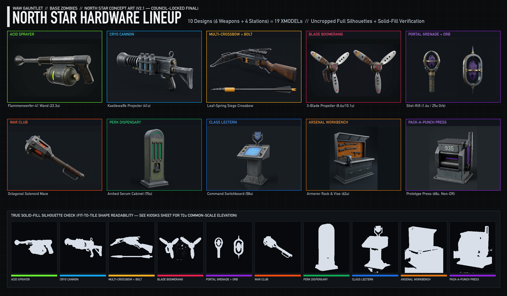
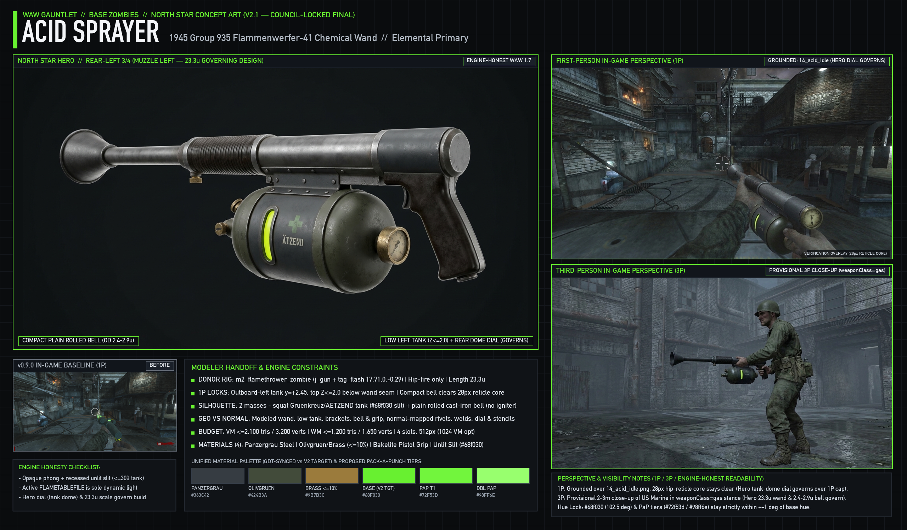
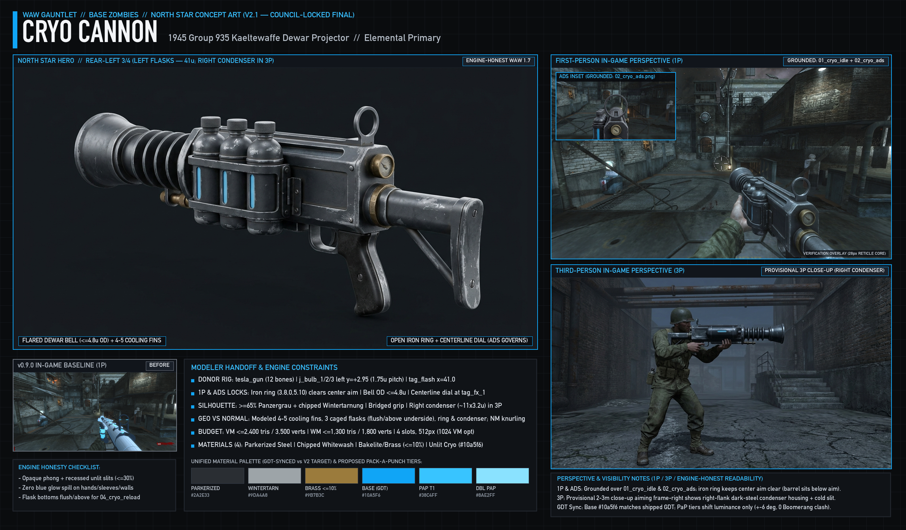
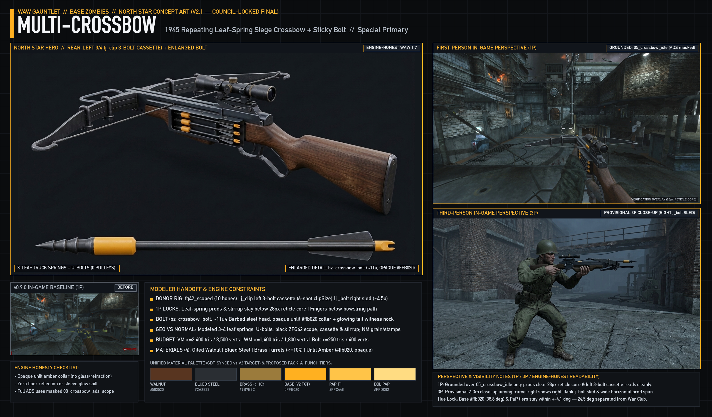
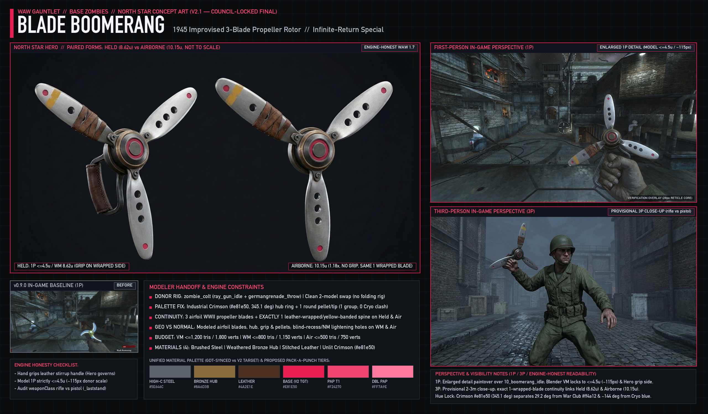
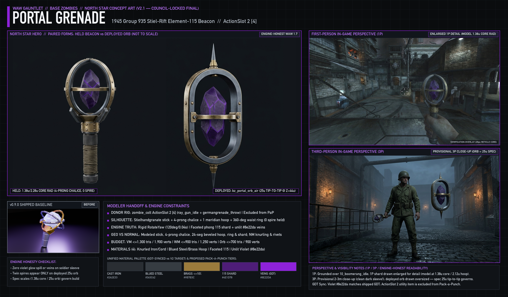
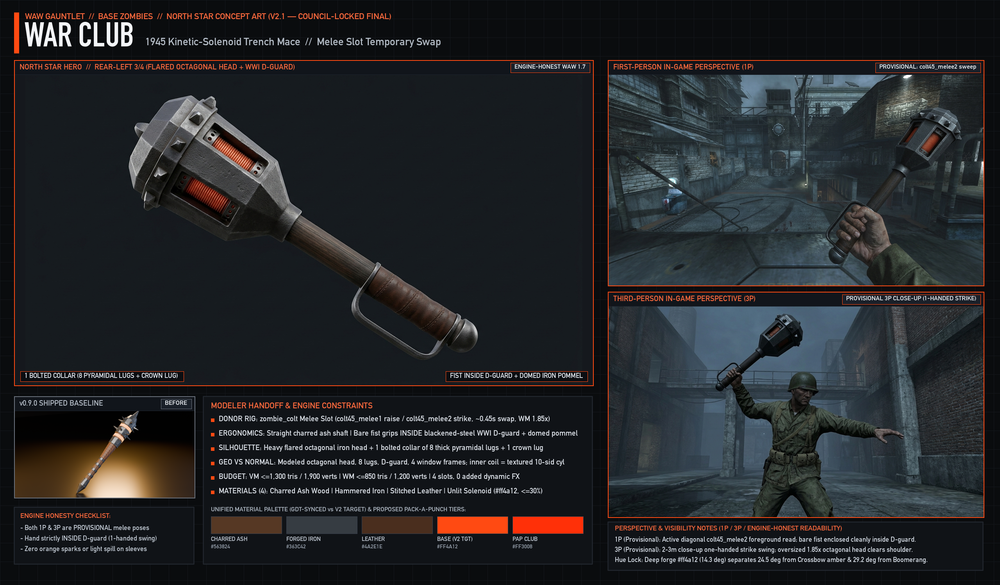
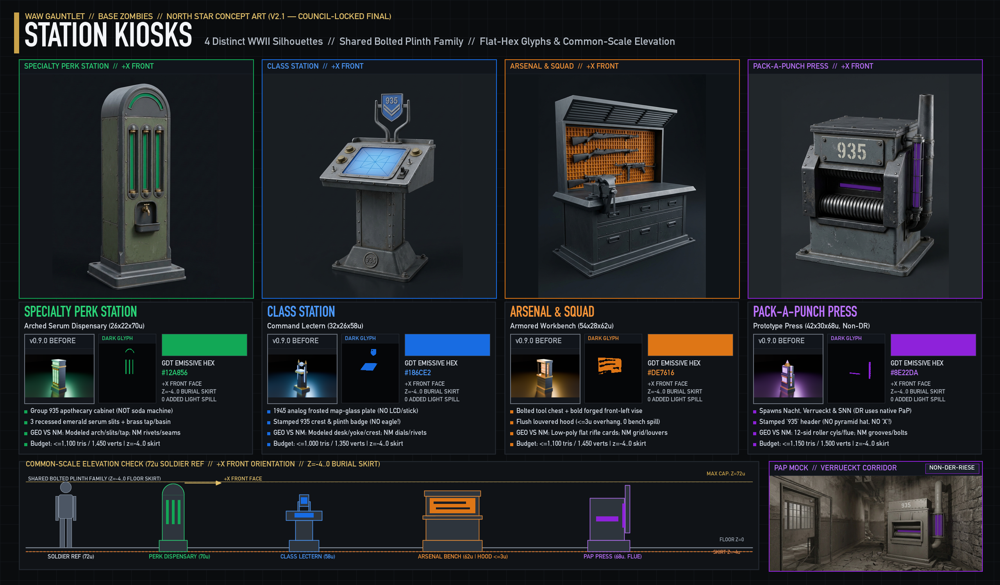

### Expansion Pack (Sheets 09–11 — v3.1 Council-Locked)

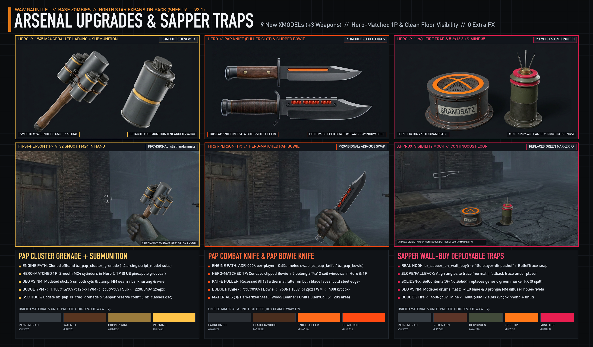
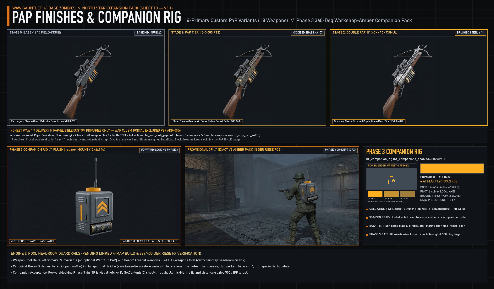
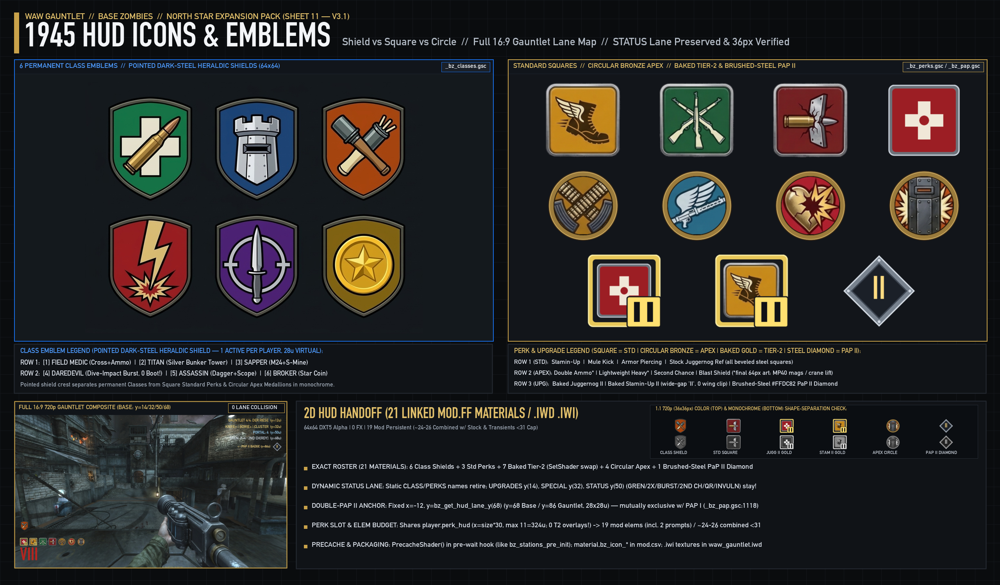
